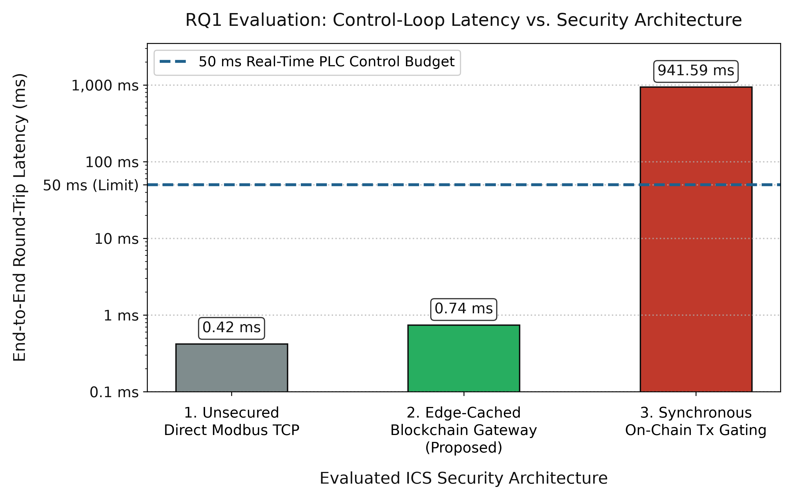
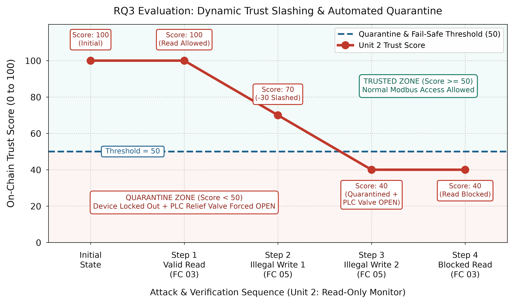

# IEC 62443 Edge-Assisted Blockchain Security Conduit for Modbus TCP

Hands-on ICS security testbed implementing an Edge-Assisted Blockchain Security Conduit for real-time Role-Based Access Control (RBAC), Dynamic Trust Slashing, Automated PLC Fail-Safe Actuation, and SHA-256 Merkle Batch Data Integrity over Modbus TCP.

## Core Architecture & Scripts
- `IIoTAssurance.sol` / `setup_blockchain.py`: Unified Solidity 0.8.20 smart contract and Ganache deployment script.
- `plc_simulator.py`: Simulated Industrial Steam Boiler PLC (Modbus TCP Port 5020).
- `edge_gateway.py`: IEC 62443 Edge Security Conduit (Port 5021) with sub-millisecond permission caching (RQ1) and automated fail-safe actuation (RQ3).
- `scenario_1_unsecured.py` & `scenario_2_edge_secured.py`: Legacy Baseline vs. Edge-Secured Conduit demonstration scripts.
- `benchmark_and_attack.py`: Automated evaluation suite for latency benchmarking, insider trust slashing, and historian Merkle tamper detection.
- `test_iptables_redirect.py`: Kernel-level `iptables` DNAT redirection preventing direct Port 5020 bypass attacks.

## Empirical Evaluation Results
### RQ1: Control-Loop Latency Benchmark

### RQ3: Dynamic Trust Slashing & Automated PLC Fail-Safe

